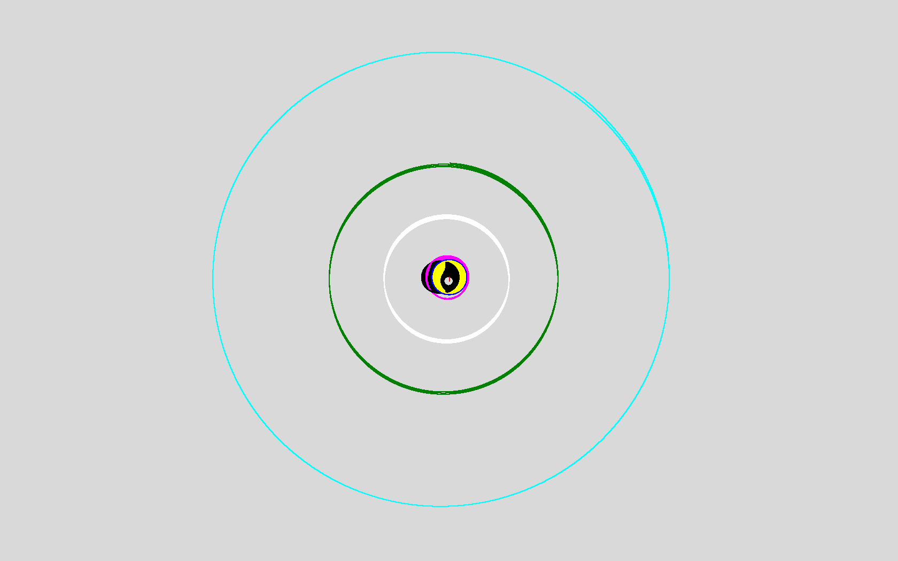
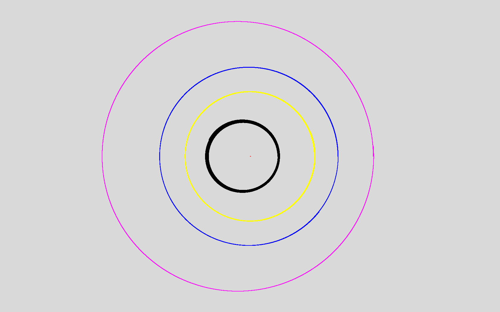
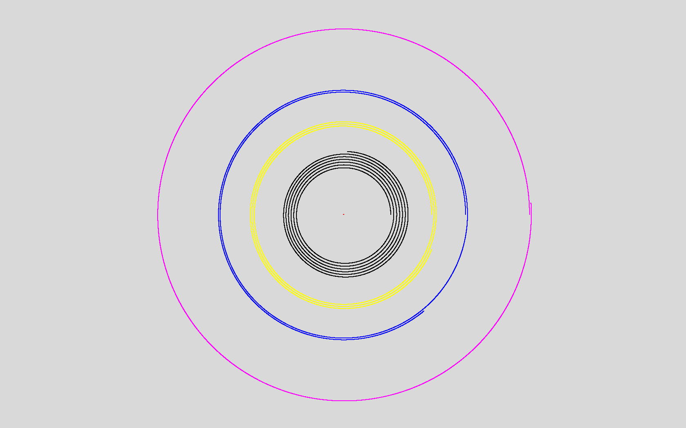
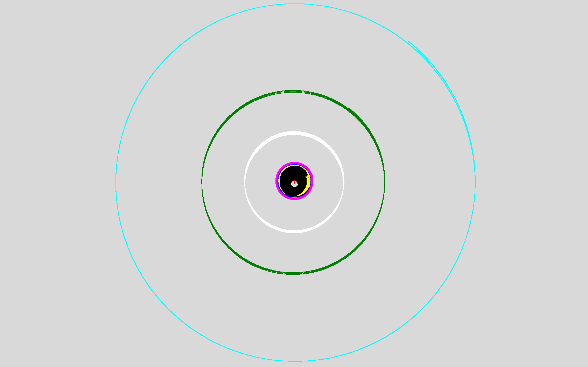
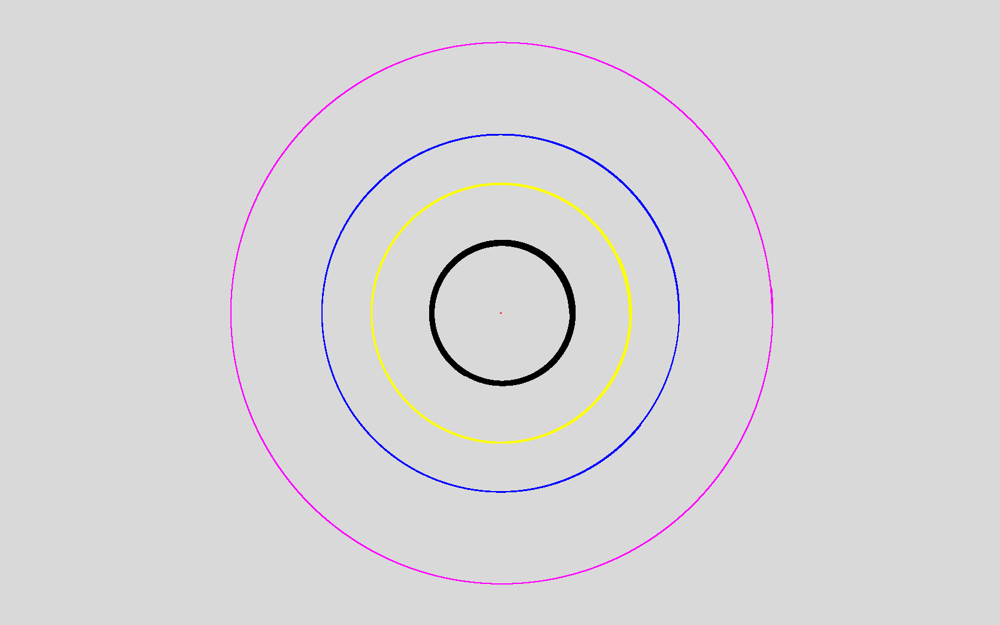

# nbody

C/Fortran OpenMP Parallel N-Body Simulation

## Build and run

Run these commands from the repository root. Each program takes
`<nsteps> <dt> <G> <softening> <parameters_file>`. The parameters file starts
with the particle count, followed by one `m x y z vx vy vz` row per particle.
All values use SI units: `nsteps` and the particle count are counts, `dt` is
seconds, `G` is m^3 kg^-1 s^-2, masses are kg, positions are m, and velocities
are m/s. `softening` is in m^2 because it is added to the squared distance in
the force calculation; keep it positive to avoid division by zero for
self-interactions. Simulation coordinates are written to stdout in meters.

### C

```sh
gcc -O2 src/nbody_serial.c -lm -o nbody_serial_c
./nbody_serial_c 100000 1e3 6.6743e-11 1 \
  parameters/solar_ellipse_c.txt > result_c.txt

gcc -O2 -fopenmp src/nbody_parallel.c -lm -o nbody_parallel_c
./nbody_parallel_c 100000 1e3 6.6743e-11 1 \
  parameters/solar_ellipse_c.txt > result_parallel_c.txt
```

### Fortran

```sh
gfortran -O2 src/nbody_serial.f90 -o nbody_serial_fortran
./nbody_serial_fortran 100000 1d3 6.6743d-11 1 \
  parameters/solar_ellipse_fortran.txt > result_fortran.txt

gfortran -O2 -fopenmp src/nbody_parallel.f90 -o nbody_parallel_fortran
./nbody_parallel_fortran 100000 1d3 6.6743d-11 1 \
  parameters/solar_ellipse_fortran.txt > result_parallel_fortran.txt
```

## Utility scripts

### 2D visualizer

`tools/simulate2d.py` opens a Tk window and plots each particle's x/y positions
from a simulation output file. It needs a graphical display and Tkinter. The
window is maximized by default, with the origin at the canvas center.

```sh
python3 tools/simulate2d.py result_c.txt -1 2e-9
```

The usage is `simulate2d.py <result_file> [max_step [scale [center_x center_y [width height]]]]`.
Omit `max_step` or set it to `-1` to plot all available steps. `scale` is in
pixels per meter (default `1`). `center_x` and `center_y` set the plot center
in pixels (otherwise it is centered automatically); `width` and `height`
optionally set the canvas size in pixels.

### Random parameter generator

`tools/mkrandparam.py` writes a parameter file with randomly generated values.
It samples each value uniformly within its bounds and writes to stdout. Redirect
that output to a file, then pass the file to a simulation executable. The count
is unitless; mass bounds are in kg, position bounds in meters, and velocity
bounds in m/s. Arguments are supplied in this order: count; mass minimum and
maximum; x, y, z minima; x, y, z maxima; vx, vy, vz minima; vx, vy, vz maxima.

```sh
python3 tools/mkrandparam.py 100 1e20 1e24 \
  -1e9 -1e9 -1e9 1e9 1e9 1e9 \
  -1e3 -1e3 -1e3 1e3 1e3 1e3 > random_parameters.txt
```

## Example Outputs

### Solar System (Ellipse)




### Solar System (Circle)






