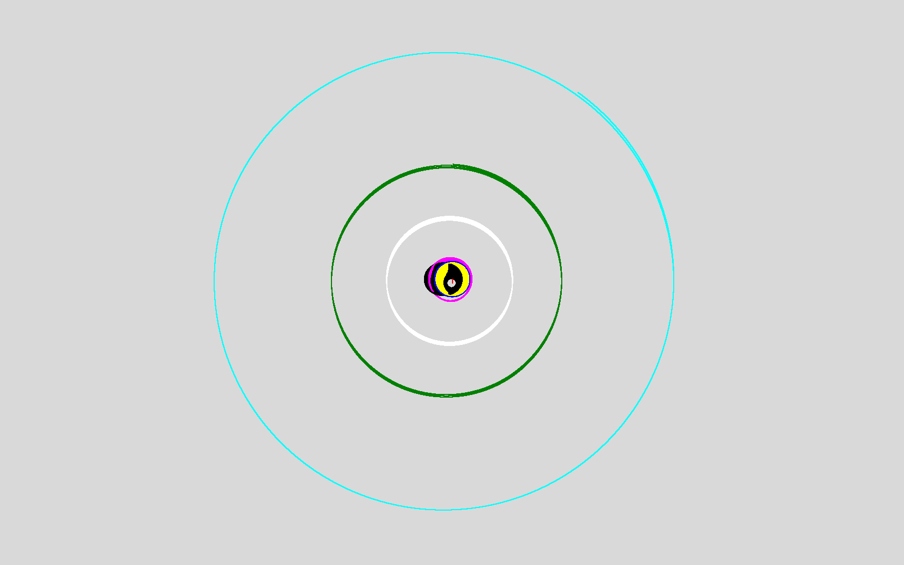
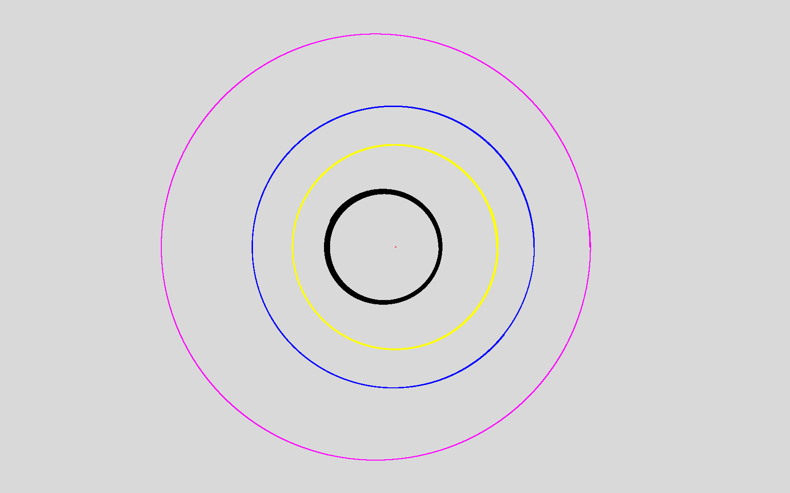
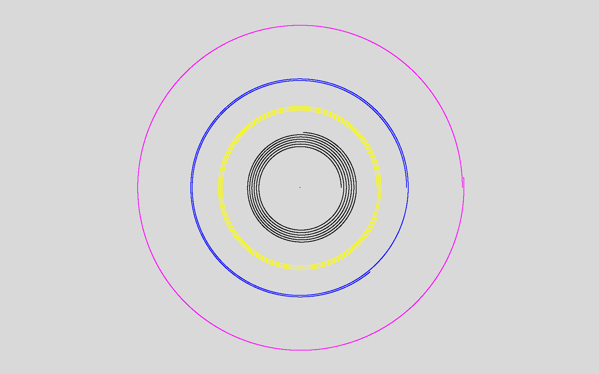
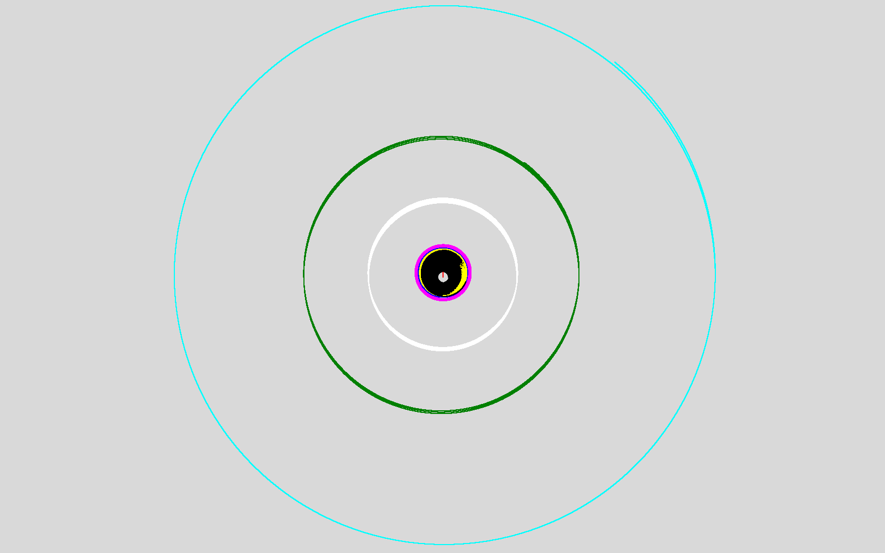
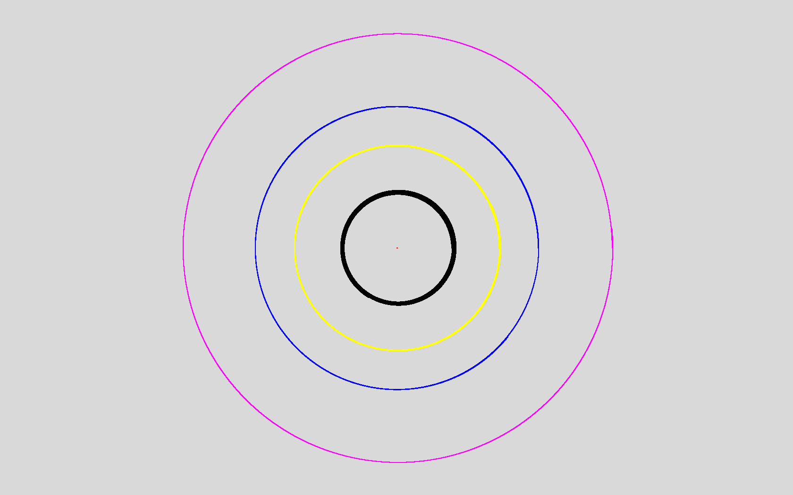

# nbody

C/Fortran OpenMP Parallel N-Body Simulation

The repository contains serial and OpenMP-parallel N-body programs in C
and Fortran. It includes two example inputs that show when parallelization
fails and when it succeeds:

- `parameters/solar_ellipse_c.txt` and
  `parameters/solar_ellipse_fortran.txt` describe the solar system with
  only 8 particles. This is an intended **parallelization-failure**
  example: each step has too little work to share, so parallel execution
  is expected to be slower than serial execution.
- `parameters/random_2000.txt` contains 2000 particles. This is the
  **parallelization-success** example: with enough work per step,
  parallel execution is expected to pay off.

## Build and run

Run these commands from the repository root. Each program takes
`<nsteps> <dt> <G> <softening> <parameters_file>`. The parameters file starts
with the particle count, followed by one `m x y z vx vy vz` row per particle.
All values use SI units: `nsteps` and the particle count are counts, `dt` is
seconds, `G` is m^3 kg^-1 s^-2, masses are kg, positions are m, and velocities
are m/s. `softening` is in m^2 because it is added to the squared distance in
the force calculation; keep it positive to avoid division by zero for
self-interactions. Simulation coordinates are written to stdout in meters.

The parallel programs use `OMP_NUM_THREADS` to set the thread count; choose
a value appropriate for your machine and problem size. The examples below
set it explicitly.

Build the C programs:

```sh
gcc -O2 src/nbody_serial.c -lm -o nbody_serial_c
gcc -O2 -fopenmp src/nbody_parallel.c -lm -o nbody_parallel_c
```

Build the Fortran programs:

```sh
gfortran -O2 src/nbody_serial.f90 -o nbody_serial_fortran
gfortran -O2 -fopenmp src/nbody_parallel.f90 -o nbody_parallel_fortran
```

### Example 1: Solar system (parallelization failure)

The solar-system inputs contain only 8 particles, and the programs print
every particle at every step. Even with 100000 steps, each step has just
64 force calculations to divide among the threads. OpenMP barrier and
output overhead therefore tend to dominate, and the parallel programs are
expected to be slower than the serial ones. This is the intended
parallelization-failure example: parallelizing a problem does not
automatically make it faster.

C:

```sh
time ./nbody_serial_c 100000 1e3 6.6743e-11 1 \
  parameters/solar_ellipse_c.txt > result_serial_c.txt
time env OMP_NUM_THREADS=2 ./nbody_parallel_c 100000 1e3 6.6743e-11 1 \
  parameters/solar_ellipse_c.txt > result_parallel_c.txt
```

Fortran:

```sh
time ./nbody_serial_fortran 100000 1d3 6.6743d-11 1 \
  parameters/solar_ellipse_fortran.txt > result_serial_fortran.txt
time env OMP_NUM_THREADS=2 ./nbody_parallel_fortran 100000 1d3 6.6743d-11 1 \
  parameters/solar_ellipse_fortran.txt > result_parallel_fortran.txt
```

### Example 2: 2000 particles (parallelization success)

`parameters/random_2000.txt` is a committed 2000-particle input with
random masses, positions, and velocities. The 100-step run is intended
to give each thread enough work to amortize the parallel overhead. The
commands below discard the per-step output because formatting it can
dominate the measurement.

C:

```sh
time ./nbody_serial_c 100 1e3 6.6743e-11 1 \
  parameters/random_2000.txt > /dev/null
time env OMP_NUM_THREADS=8 ./nbody_parallel_c 100 1e3 6.6743e-11 1 \
  parameters/random_2000.txt > /dev/null
```

Fortran:

```sh
time ./nbody_serial_fortran 100 1d3 6.6743d-11 1 \
  parameters/random_2000.txt > /dev/null
time env OMP_NUM_THREADS=8 ./nbody_parallel_fortran 100 1d3 6.6743d-11 1 \
  parameters/random_2000.txt > /dev/null
```

## Utility scripts

### 2D visualizer

`tools/simulate2d.py` opens a Tk window and plots each particle's x/y positions
from a simulation output file. It needs a graphical display and Tkinter. The
window is maximized by default, with the origin at the canvas center.

```sh
python3 tools/simulate2d.py result_serial_c.txt -1 2e-9
```

The usage is `simulate2d.py <result_file> [max_step [scale [center_x center_y [width height]]]]`.
Omit `max_step` or set it to `-1` to plot all available steps. `scale` is in
pixels per meter (default `1`). `center_x` and `center_y` set the plot center
in pixels (otherwise it is centered automatically); `width` and `height`
optionally set the canvas size in pixels.

### Random parameter generator

`tools/mkrandparam.py` writes a parameter file with randomly generated values.
It samples each value uniformly within its bounds and writes to stdout. Redirect
that output to a file, then pass the file to a simulation executable. The count
is unitless; mass bounds are in kg, position bounds in meters, and velocity
bounds in m/s. Arguments are supplied in this order: count; mass minimum and
maximum; x, y, z minima; x, y, z maxima; vx, vy, vz minima; vx, vy, vz maxima.

```sh
python3 tools/mkrandparam.py 100 1e20 1e24 \
  -1e9 -1e9 -1e9 1e9 1e9 1e9 \
  -1e3 -1e3 -1e3 1e3 1e3 1e3 > random_parameters.txt
```

## Example Outputs

### Solar System (Ellipse)




### Solar System (Circle)






